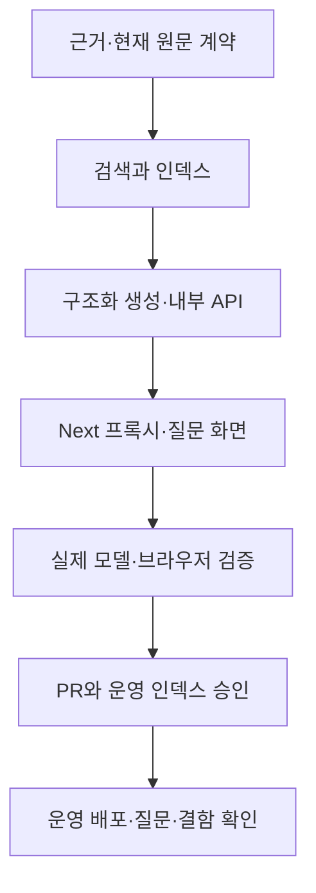

# 법안 질의응답 출시 — 구현 계획

| 파일 | 변경 |
| --- | --- |
| `services/ai/src/lawdigest_ai/rag/{chatbot,embedding,vector_store}.py` | 현재 SDK 검색·임베딩·구조화 답변 계약 |
| 새 `rag/{schemas,settings,repository,indexing,api,limits}.py` | 입력/출력·원문 대조·인덱스·내부 API·요청 한도 |
| `services/ai/tools/index_rag_bills.py`, `requirements-rag.txt`, `rag.env.example`, `pyproject.toml`의 rag 추가 의존성 | dry_run 기본 인덱스 명령, 전용 의존성·설정 예시 |
| `rag/local_embedding.py`, `tools/prepare_rag_embedding_model.py` | 고정 E5 int8 ONNX 파일 검증, CPU 임베딩, E5 토큰 길이 내 원문 분할 |
| `services/ai/tests/rag/` | 근거·인덱스·API·오류·한도·공식 SDK 경계 회귀 |
| `services/web/app/api/qa/route.ts`, `lib/ragProxy.ts` | 내부 인증·상태·질문 프록시, 요청 크기·시간 제한 |
| `services/web/app/ask/{page,layout,AskClient}.tsx`, `components/qa/`, `hooks/useRagConversation.ts`, `store/RagConversationState.tsx` | 실제 질문·후속 대화·출처·취소·재시도·복원 |
| `services/web/components/common/SearchBar/SearchModal.tsx`, `components/Layout/Nav/Nav.tsx` | 기존 검색에서 실제 질문 기능으로 진입 |
| 필요한 `services/web/components/ui/`, `package*.json` | shadcn CLI로 확인한 대화·메시지·상태·범위 선택 컴포넌트 |
| `services/web/lib/*rag*.test.*`, 질문 화면·훅 회귀 검사 | 요청 경계·대화 보존·근거·실패·IME 조작 |
| `deploy/deploy-rag.sh`, `deploy/PROD_RAG_DEPLOY.md`, AI README·질의응답 검증 기록 | 루프백 서비스의 main 배포·상태 확인·원복·인덱스 승인 절차 |

1. 세 아티팩트를 각각 커밋한다. PR #153의 기존 웹 수정을 기반으로 하며 머지 전에는 의존 관계를 명시한다.
2. 근거 모델·읽기 전용 DB 대조·인덱스 계약과 검색을 먼저 구현하고 잘못된 근거를 거절하는 회귀 검사를 통과한다.
3. 구조화 생성·요청 한도·내부 API·Next 프록시를 연결하고 실제 요청에서 실패와 근거 부족을 구분한다.
4. shadcn CLI에서 대화 컴포넌트를 확인한 뒤 기존 셸에 질문 화면을 연결한다. IME·중지·재시도·출처 왕복을 검증한다.
5. 별도 임시 인덱스에서 공개 법안과 실제 CPU 임베딩을 확인한다. 답변 모델의 원문 대조를 별도로 검증한다. 운영 MySQL·Qdrant 쓰기를 하지 않는다.
6. 린트·테스트·빌드·실제 화면 결과를 기록하고 커밋·푸시·PR로 전달한다. 승인 뒤 전체 인덱스 구축·main 배포·운영 질문을 검증한다.

가장 위험한 단계는 불완전한 인덱스와 잘못된 출처를 정상 답변으로 내보내는 것이다. 스키마·현재 내용 해시·참조 ID를 검사하고 실패는 별도 상태로 보낸다. 인덱스 구축은 기존 컬렉션을 덮어쓰지 않고 검증 후 버전을 전환한다. 실패 시 이전 인덱스·서비스 release로 복구한다.

검증 명령: 변경 Python Ruff 및 rag pytest, `uv build services/ai`, 웹 `npm run lint`, `npm test`, `npx tsc --noEmit`, `npm run build`, 배포 스크립트 `bash -n`. 실제 모델·Qdrant 검색과 1440px·375px 라이트/다크 조작 결과를 별도로 기록한다. 운영 인덱스 구축·증분 갱신·timer와 운영 DB 쓰기는 각각 승인 범위를 지킨다.
