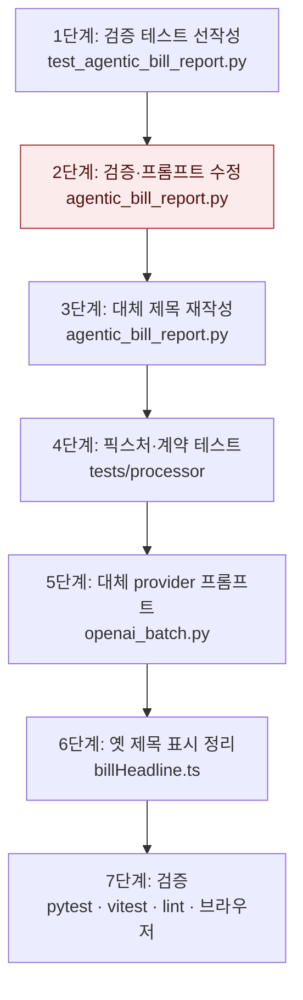

# 법안 제목을 "~하기 위한 법안" 설명형으로 바꾸기 — 구현 계획

## 바뀌는 파일

| 파일 | 무엇을 |
|---|---|
| `services/ai/src/lawdigest_ai/processor/agentic_bill_report.py` | 프롬프트 3곳, 제목 검증, 대체 제목 생성, 하드코딩 주제 삭제 |
| `services/ai/src/lawdigest_ai/processor/providers/openai_batch.py` | `title` 필드 설명과 프롬프트 제목 규칙 |
| `services/ai/tests/processor/test_agentic_bill_report.py` | 계약 문자열, 검증·대체 제목 테스트, 픽스처 제목 |
| `services/ai/tests/processor/test_summarizer.py` | 프롬프트 계약 문자열 |
| `services/ai/tests/processor/test_gemini_cli_summarizer.py` | 프롬프트 계약 문자열 |
| `services/web/lib/billHeadline.ts` | 옛 제목을 "~위한 법안"으로 정리 |
| `services/web/lib/billHeadline.test.ts` | 기대값 갱신 |

## 작업 순서

1. 검증 테스트를 새 계약으로 먼저 고친다 — 실행하면 실패한다.
2. `_validate_generated_title`과 프롬프트 3곳을 고친다 — 1단계 테스트 통과.
3. `_build_title_from_report`를 다시 쓰고 `_title_topic_from_bill_name`, `_has_overlong_title_prefix`를 지운다. 관련 테스트를 새 형식으로 바꾼다.
4. 픽스처 제목과 프롬프트 계약 문자열 테스트를 고친다 — AI 테스트 전체 통과.
5. `openai_batch.py` 프롬프트를 고친다 — `test_summarizer`, `test_gemini_cli_summarizer` 통과.
6. `billHeadline.ts`와 테스트를 고친다 — vitest 통과.
7. 로컬 웹 화면 확인, 린트, 커밋, 푸시.



## 가장 위험한 단계

2단계. 하한 25자 검증이 운영에서 너무 많은 리포트를 실패시킬 수 있다. 실패한 법안은 제목·요약이 저장되지 않고 다음 실행에서 다시 대상이 된다. 실패가 많으면 `_validate_generated_title`의 하한 상수 하나를 낮추는 커밋으로 되돌린다.

## 검증

```
cd services/ai && .venv/bin/python -m pytest tests -q
cd services/ai && .venv/bin/ruff check src tests
cd services/web && npx vitest run lib/billHeadline.test.ts && npm run lint
```

화면: 로컬 웹(운영 API 연결)의 홈 피드에서 카드 제목이 "~위한 법안"으로 끝나고 정식 법안명이 둘째 줄에 있는지, 리포트 피드와 타임라인 제목도 같은지 본다.
