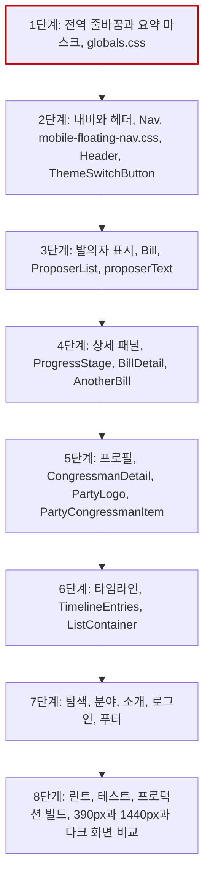

# 작업 순서

# 가장 위험한 단계

1단계는 모든 화면에 영향을 준다. 긴 영문·숫자 문자열과 좁은 열에서 넘침이 생길 수 있다. 전 경로의 `scrollWidth`를 측정해 확인하고, 문제가 있으면 전역 규칙을 제목과 본문 선택자로 좁힌다.

# 검증

- `npm run lint`, `npm test`, `npm run build`
- 로컬 프로덕션 서버를 운영 API에 연결하고 `view_count` PATCH를 차단한 뒤 전 경로를 1440px, 390px, 다크 모드로 캡처한다.
