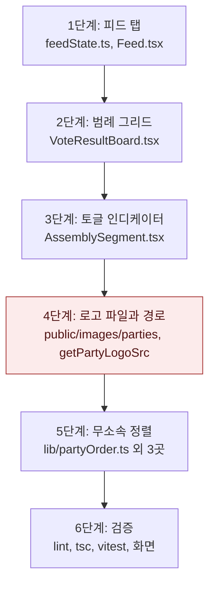

# 피드 기본 탭·표결 범례·국회 토글·정당 로고 정리 — 구현 계획

## 바뀌는 파일

| 파일 | 무엇을 |
|---|---|
| `services/web/lib/feedState.ts` | 기본 탭을 `bill`로 |
| `services/web/components/Feed/Feed/Feed.tsx` | 탭 순서, 법안 클릭 시 `tab` 제거 |
| `services/web/app/bill/[id]/components/ProcessResult/VoteResultBoard.tsx` | 유동 그리드, 로고 원 `overflow-hidden`, 무소속 정렬 |
| `services/web/app/explore/components/AssemblySegment.tsx` | 이동 인디케이터 |
| `services/web/public/images/parties/wide/{36,39,62}.png`, `dark/{36,62}.png` | 새 로고 파일 |
| `services/web/utils/getPartyLogoSrc.ts`, `.test.ts` | 로컬 로고 ID 추가와 테스트 |
| `services/web/app/mypage/components/Party/PartyItem.tsx` 외 2개 | `getPartyLogoSrc` 사용 |
| `services/web/lib/partyOrder.ts`, `.test.ts` (새 파일) | 무소속 맨 뒤 정렬 |
| `services/web/app/explore/components/PartyList.tsx`, `SeatDistribution.tsx` | 무소속 정렬 적용 |

## 작업 순서

1. 피드 기본 탭과 순서 — `/` 접속 시 법안 탭 선택 확인
2. 표결 범례 그리드 — 1280px 타임라인에서 2열, 잘린 정당명 없음
3. 토글 인디케이터 — 클릭 후 인디케이터 좌표가 시간에 따라 이동
4. 로고 파일 추가와 경로 통일 — `/_next/image`로 36·62가 200 응답
5. 무소속 정렬 — 정당 목록·의석 범례 마지막이 무소속
6. 린트·타입 검사·테스트



## 가장 위험한 단계

4단계. 로컬 로고가 원본과 다르면 운영 화면의 로고가 바뀐다. 원본과 같은 파일을 쓰는 것으로 막고, 문제가 생기면 ID를 로컬 목록에서 빼면 원격 주소로 돌아간다.

## 검증

```
cd services/web && npm run lint && npx tsc --noEmit -p tsconfig.json && npx vitest run
```

화면: `/`(피드 탭), `/timeline`(1280px·375px 범례), `/explore` › 국회(토글, 정당 목록, 의석 범례).
