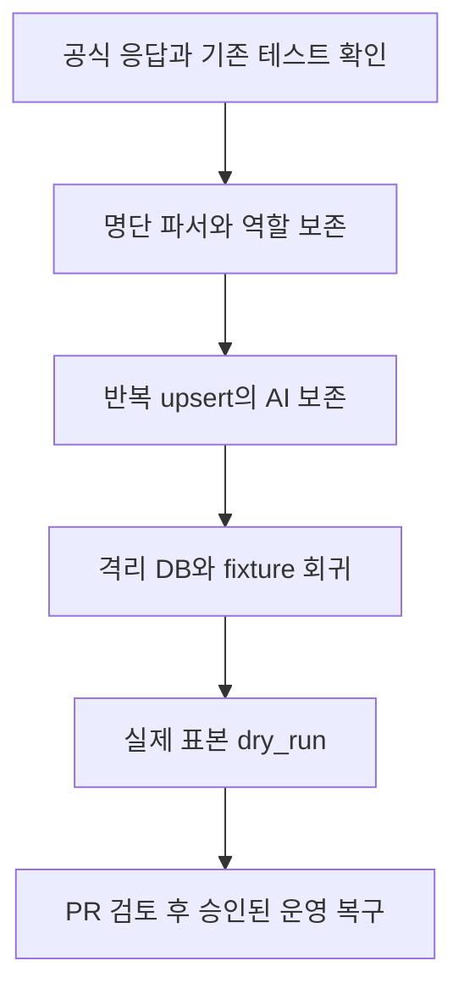

# 법안 재수집과 최신 발의자 정보 복구 — 구현 계획

| 파일 | 변경 |
| --- | --- |
| `services/data/src/lawdigest_data/bills/DataFetcher.py`, 새 `bills/likms_proposers.py` | 공식 상세·팝업 파싱과 전체 명단 확인, API 빈 응답 보완 및 유일한 ID 매칭 |
| `services/data/src/lawdigest_data/bills/DataProcessor.py` | 확인된 대표발의자 ID 사용, 발의자 설명 추출 제한 |
| `services/data/src/lawdigest_data/connectors/DatabaseManager.py` | AI 필드·제목 보존을 포함한 반복 upsert |
| 관련 `services/data/tests/` 및 공개 HTML fixture | 역할·완전성·실패 회귀와 격리 MySQL 반복 적재 |
| `docs/data/법안 데이터 파이프라인/pipeline_restart_runbook.md` | 검증 결과와 백필 선행 조건 기록 |

1. 세 아티팩트를 각각 커밋한다. 기존 명세와 실제 공식 HTML을 기준으로 실패 사례를 확보한다.
2. 공식 팝업의 구조·페이지 계약을 확인하고 파서와 보완 수집을 구현한다. 알려진 역할을 끝까지 보존한다.
3. 실제 MySQL에서 재수집 시 AI 필드가 소실되는 사례를 재현한 뒤 upsert를 수정한다. 새 AI 값의 명시적 갱신도 확인한다.
4. 변경 Python 파일 정적 검사, 관련 pytest와 data 회귀 검사를 실행한다. 실제 표본 dry_run을 실행하고 결과를 기록한다.
5. 커밋·푸시·한국어 PR을 작성한다. 백필·timer는 구체적인 명령과 범위를 준비한 후 각각 별도 승인을 받는다.

가장 위험한 단계는 역할을 잘못 매칭한 명단을 적재하는 것이다. 전체 인물과 대표 역할을 증명하지 못하면 해당 법안을 거절한다. 구조 변경 시에도 기존 API와 거절 동작으로 돌아가야 한다. 검증은 root의 기존 data 가상환경을 재사용하되 PYTHONPATH와 conftest로 이 워크트리 소스를 먼저 가져온다. 실제 DB 검사는 127.0.0.1 전용 임시 DB만 허용한다. 현재 사용 중인 다른 DB·서비스에는 연결하지 않는다.
