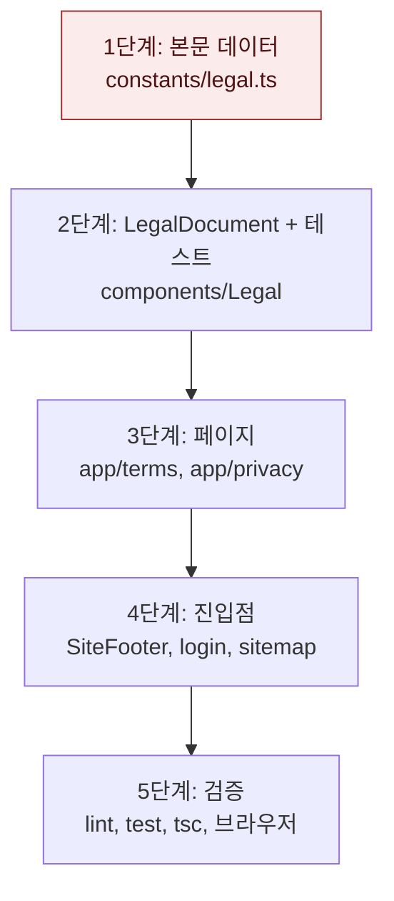

# 이용약관과 개인정보 처리방침 공개 — 구현 계획

## 바뀌는 파일

| 파일 | 무엇을 |
|---|---|
| `services/web/constants/legal.ts` (새로) | 운영자 정보, 시행일, 약관·처리방침 본문 데이터 |
| `services/web/components/Legal/LegalDocument.tsx` (새로) | 제목·시행일·목차·조항·표 렌더링 |
| `services/web/components/Legal/LegalDocument.test.tsx` (새로) | 목차 앵커와 조항 id 일치, 표 렌더링 검사 |
| `services/web/app/terms/page.tsx` (새로) | 이용약관 페이지 |
| `services/web/app/privacy/page.tsx` (새로) | 개인정보 처리방침 페이지 |
| `services/web/components/Layout/SiteFooter.tsx` | 이용약관·개인정보 처리방침 링크 |
| `services/web/app/login/page.tsx` | 동의 안내, 만 14세 안내 |
| `services/web/lib/sitemap.ts` | `/terms`, `/privacy` 추가 |

## 작업 순서

1. 본문 데이터 작성(`constants/legal.ts`) — 타입 검사 통과
2. `LegalDocument` 컴포넌트와 테스트 — `npm run test -- LegalDocument` 통과
3. 두 페이지 추가 — 개발 서버에서 `/terms`, `/privacy` 200
4. 하단 링크, 로그인 안내, 사이트맵 — 화면에서 링크 이동 확인
5. 검증 — 린트, 테스트, 타입 검사, 브라우저 확인

## 가장 위험한 단계

1단계 본문 데이터. 문서 내용이 실제 처리와 다르면 법적 고지가 틀린다. 각 수집 항목·보유 기간을 spec의 처리 사실 근거와 하나씩 대조한다. 되돌릴 때는 해당 문구만 고친다.

## 검증

```
cd services/web
npm run lint
npm run test
npx tsc --noEmit
```

UI 확인: 개발 서버에서 `/privacy` 목차 클릭 시 해당 조항으로 이동, 375px 폭에서 표가 가로 스크롤, `/login` 안내 문구, `/mypage` 하단 링크, 다크 모드 대비.


