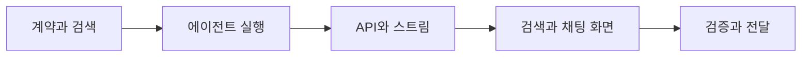

# RAG 검색과 에이전틱 채팅 구현 계획

## 구현 순서
1. schemas/chatbot에 검색 응답과 공통 출처 검증을 추가한다.
2. agent 모듈에 제한된 모델 결정 루프와 검색/조회 도구를 구현한다. Codex 생성기에 스키마 선택과 취소를 연결한다.
3. FastAPI 및 Next 프록시에 검색과 채팅 경로, SSE 상태 전송, 취소 전파를 추가한다.
4. 웹 계약·대화 hook·/ask에 검색 선택과 실행 상태를 연결한다.
5. 원문 변경·대수 범위·조회 권한·도구 횟수·취소·불완전 스트림을 검증하고 린트·타입검사·빌드를 수행한다.

## 검증
Python RAG 회귀 및 실제 로컬 Qdrant 테스트, 웹 RAG 프록시/스트림/hook/화면 테스트, ESLint, TypeScript, Next 빌드. 모델·운영 서비스 연결은 별도 실행 여부와 결과를 기록한다.

## 근거
- Expresso services/backend/src/platform/agent/runtime.ts, modules/agent-chat/service.ts 및 routes.ts, 웹 useAgentConversation.ts.
- https://learn.chatgpt.com/docs/developer-commands#codex-exec
- https://fastapi.tiangolo.com/advanced/custom-response/#streamingresponse
- https://ui.shadcn.com/docs/components/radix/toggle-group
