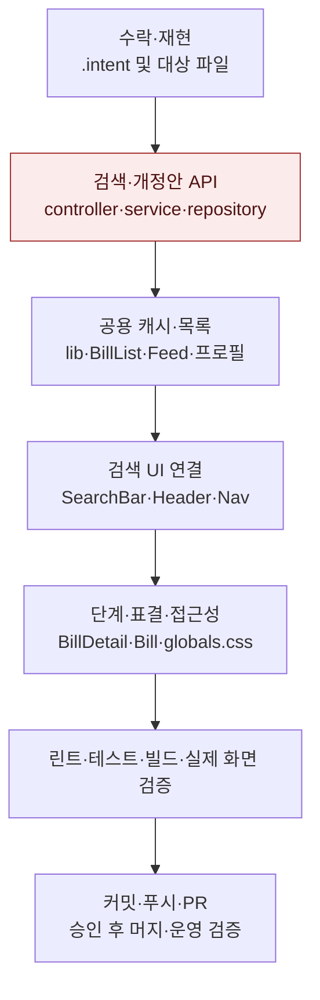

# 모두의입법 1차 핵심 화면 복구 — 구현 계획

## 바뀌는 파일

아래 경로는 저장소 루트 기준이다. 중괄호는 같은 디렉터리의 파일들을 묶어 쓴 것이다. 구현 중 파일 범위가 달라지면 같은 커밋에서 이 표를 갱신한다.

| 파일 | 변경 |
| --- | --- |
| `services/web/components.json`, `components/ui/` 아래 필요한 컴포넌트, `lib/utils.ts` | 새 shadcn 설정·공용 컴포넌트. 기존 cn 유틸이 있으면 재사용한다. 이후 웹 경로는 services/web 기준이다. |
| `package.json`, `package-lock.json`, `styles/globals.css`, `tailwind.config.js` | 필요한 UI 의존성·토큰만 추가하고 다크 피드 탭을 보정한다. |
| `lib/billQueries.ts`, `lib/search.ts`, `lib/billStage.ts` | 새 공용 query options·입력/URL·단계 해석. 기존 유틸과 통합 가능하면 중복 생성하지 않는다. |
| `components/Bill/BillList/BillList.tsx`, `hooks/useIntersect.ts` | 페이지 관찰·로딩·끝 상태 공용화. |
| `components/Feed/Feed/{Feed,FollowingFeed}.tsx`, `components/Feed/Feed/apis/{apis,queries}.ts`, `app/page.tsx` | 피드 캐시·URL 상태·서버 hydration. |
| `app/{congressman,party}/[id]/components/BillContainer/BillContainer.tsx`, 해당 `apis/` 파일 | 발의 유형별 캐시·페이지 끝 처리·복제 상태 제거. |
| `app/following/apis/{apis,queries}.ts`, `app/mypage/`의 BillList 호출부 | 공용 목록 변경에 필요한 호출부와 페이지 크기 반영. |
| `app/search/apis/{apis,queries}.ts`, `app/search/[id]/{page,SearchResultClient}.tsx`, `app/search/[id]/components/{SearchList,SearchCongressman,SearchParty}.tsx` | 검색 hydration·유형별 상태·결과 정렬·펼치기. |
| `components/common/SearchBar/{SearchBar,SearchModal,SearchBarButton}.tsx`, `components/common/Button/SearchButton.tsx` | 공용 검색 Dialog·폼·최근 검색어·포커스. |
| `components/Layout/{Header/Header,Nav/Nav}.tsx`, `store/SearchModalState.tsx`, `app/explore/components/TrendingKeywords.tsx` | 검색 진입·경로·상태 공유. 자연어 질문은 후속 RAG 계약과 연결할 수 있게 구분한다. |
| `constants/bill.ts`, `types/type/{bill/bill,search/searchCongressmanParty}.ts` | 단계·결과·null 표결·추가 응답 필드 계약. |
| `app/bill/[id]/components/{BillDetail/BillDetail,ProgressStage/ProgressStage,ProcessResult/ProcessResult,ProcessResult/VoteResultBoard,AnotherBill/AnotherBillList,AnotherBill/AnotherBill}.tsx`, `components/common/Chart/HalfDonutChart.tsx`, `app/bill/[id]/{page.tsx,apis/}` | 종료·미수집 표시, 실제 표결 분모, 개정안 페이지 연결과 메타 정합. |
| `components/Bill/BillList/Bill/{SafeBillSummaryHtml,Bill}.tsx` | 일반 요약 콘텐츠와 별도 펼치기 버튼. |
| `services/backend/src/main/java/com/everyones/lawmaking/controller/{SearchController,BillController}.java` | 아래 백엔드 파일들도 같은 Java 패키지 기준. 입력 검증·개정안 페이지 API. |
| `facade/{SearchFacade,BillFacade}.java`, `service/{BillService,CongressmanService}.java`, `repository/{BillRepository,CongressmanRepository}.java` | 안전한 검색식·관련도·검색 ID 순서·의원 정렬·개정안 페이징. |
| `common/dto/{SimilarBill,SearchCongressmanDto}.java`, `common/dto/response/`의 상세·개정안 페이지 응답, `global/error/GlobalExceptionHandler.java`, 검색식 유틸 새 파일 | 응답 호환·대수와 결과 정보·400 매핑. |
| 관련 웹 회귀 테스트와 백엔드 SearchController·BillService·개정안 API 테스트 | 사용자 동작·계약·경계 조건을 검증한다. |

## 작업 순서

1. intent 수락 뒤 세 아티팩트를 intent → spec → plan 순으로 각각 커밋한다. 제품 코드를 바꾸기 전에 각 대상의 미확인 조작을 재현하고 재현 실패 항목을 제외·기록한다.
2. 현재 동작을 덮는 회귀 사례를 먼저 확보하고, 서버 검색 입력·SQL·정렬·개정안 페이지 계약을 수정한다. API와 기존 응답 필드의 호환을 확인한다.
3. 공용 query options·페이지 끝 판정을 만들고 홈·검색·프로필·팔로잉 호출부를 순서대로 연결한다. 첫 렌더·조건 전환·뒤로 가기·마지막 페이지에서 요청과 표시를 확인한다.
4. shadcn CLI로 필요한 컴포넌트와 의존성의 변경을 미리 확인한 뒤 검색 UI를 기존 셸에 연결한다. 검색 진입, 예약문자, 지우기, 최근 검색어, Esc·Tab·포커스 복귀를 실제 조작한다.
5. 단계·종료 결과·표결 미수집·개정안 표시와 요약 역할·다크 탭을 수정한다. 알려진 운영 표본을 로컬 화면에서 다시 확인한다.
6. 린트부터 실행한 뒤 테스트·타입검사·빌드를 통과하고, 데스크톱·375px·다크 화면을 확인한다. 변경분만 커밋·푸시하고 한국어 PR을 body-file로 작성한다. 머지는 사용자 승인을 받는다.
7. 승인 후 배포 스크립트·CI를 확인하고 운영 화면에서 같은 조작을 검증한다. 해결된 이슈만 닫고, 남은 W1·RAG·W3 백엔드 항목은 유지한다. 워크트리와 브랜치를 정리한다.

## 가장 위험한 단계

검색 쿼리와 개정안 API의 동반 변경이다. H2 테스트만으로 MySQL FULLTEXT 동작을 입증할 수 없다. MySQL 호환 환경에서 native query를 실행하고 기존 응답 계약을 확인한 뒤 웹과 연결한다. 서버 결과가 정상이어도 BillService의 재조회에서 순서가 바뀌지 않는지 검증한다. 운영 적용 실패 시 공식 배포 경로로 직전 백엔드·웹 release를 함께 복구한다. 이번 변경에는 운영 DB 마이그레이션을 넣지 않는다.

## 검증

웹 작업 디렉터리에서 먼저 `npm run lint`, 이어 `npm test`, `npx tsc --noEmit`, `npm run build`를 실행한다. 새 워크트리의 의존성은 `npm ci`로 설치한다. 백엔드는 Java 17 환경에서 `./gradlew test bootJar --no-daemon`을 실행한다. 전용 Java 린트 task 유무는 구현 전에 확인하고 없는 검사를 통과했다고 보고하지 않는다.

수정 전부터 실패하는 검사는 baseline과 변경으로 생긴 실패를 구분한다. MySQL 재현 환경 확보 여부와 실제 native query 결과를 기록한다. 단위 테스트 통과로 운영 검색을 검증했다고 간주하지 않는다.

수동 경로: 홈 → 단계 선택 → 상세 → 뒤로 가기 / 의료법 검색 → 두 번째 페이지 → 마지막 페이지 / 검색어 변경 → 예약문자 입력 → 지우기 / 의원·정당 대표·공동발의 전환 / 정부이송·철회·가결 미수집 상세 / 요약 용어 풀이·펼치기 / 검색 Dialog 키보드 탐색. 각 경로를 데스크톱 1440px·모바일 375px·라이트/다크에서 확인한다.

## 결정 사항과 선행 작업

- PR #136: f3bb744로 main 반영 완료. blocker는 #137~#152에 등록했다.
- 사용자 결정: 리포트 전용 계약 구현, 가결=원안가결+수정가결, RAG 출시, 21대 폐기 상태 제공·기본 22대, HOT=최근 7일 조회+스크랩, 정당 강조색 유지, 처리방침 정보 모두 미정.
- W1 읽기 전용 확인: 운영 저장소 HEAD 9e969d3. 기본 실행 로그 354줄의 마지막 이벤트는 2026-07-17 제목 재생성. 같은 로그에서 bill.ingest는 6월 24일, ai.summary는 7월 5일이 마지막 run_finished이며 bill-status-sync 기록은 찾지 못했다. 확인한 시스템 timer 목록에 관련 유닛이 없다. 다른 로그 위치·cron·수동 실행 여부는 추가 확인이 필요하다.
- 운영 타임라인 최신 날짜는 다시 확인해도 2026-03-27이다. 운영 DB 쓰기·timer 등록은 실행하지 않았다.
- 추가 확인: 사용자 cron은 매시간 존재하지 않는 소문자 lawdigest 경로의 수집 스크립트를 호출한다. 관련 사용자 timer와 실행 중 파이프라인 프로세스는 없다. 읽기 전용 트랜잭션에서 22대 법안 17,982건, 최신 발의일 2026-07-10, 분야 누락 4,751건, 요약 누락 232건을 확인했다. 21대 법안은 23,022건이다.
- 2026-11-03 사용자가 5단계까지 모든 intent 자동 수락을 지시했다. 이후 차수도 세 문서를 작성·기록한 뒤 구현하며 별도의 intent 수락 질문을 반복하지 않는다.
- 별도 RAG intent에는 서비스/API 연결, 근거 법안·출처 표시, 질문 종류별 답변 가능 범위, 인덱스 최신성, 실패·빈 근거 처리, 운영 연결 검증을 포함한다. 실제 출시까지 해당 결함을 미해결로 유지한다.
