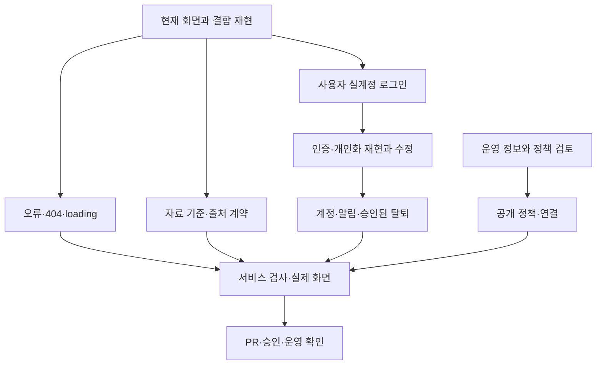

# 구현 계획

handoff의 2차 묶음을 현재 코드에서 다시 찾아 재현하고, 확인 가능한 경로부터 구현한다.

| 대상 파일 | 변경 |
| --- | --- |
| `services/web/api/{config,auth}`, 인증 상태 공용 훅·provider, `app/login/**` | 재발급·원 응답·로그인 실패·복귀와 상태 경계 |
| `services/backend/.../service/AuthService.java`, AuthController·TokenService와 관련 검사 | 실패 HTTP 상태, 쿠키·토큰 계약 |
| `app/mypage/**`, Bill·팔로우·알림·설정·탈퇴 컴포넌트와 관련 API | 개인화 정합·계정 경로·실패 복구 |
| `app/{bill,congressman,party}/[id]/**`, 공개 경로 데이터 helper, `app/{error,not-found,loading}.tsx` | 데이터 존재 확인, HTTP 404·오류·loading |
| 피드·검색·타임라인·탐색의 loading·빈 상태 공용 요소 | 현재 화면을 유지하는 복구 동작 |
| backend의 자료 기준 DTO·repository·service·controller, 통계 기간 처리 | 실제 수집 범위의 읽기 전용 계약 |
| 웹 자료 기준·원문·AI 표시 공용 요소, Feed·Bill·Timeline·Explore·Profile | 출처·날짜·수집 지연 노출 |
| 계정·서비스 소개·정책 문안, Footer·Login 링크 | 확정 정보에 따른 공개 문서와 진입점 |
| 서비스별 관련 회귀·브라우저 검증 기록 | 원인과 실제 사용자 동작 확인 |

1. intent → spec → plan을 각각 커밋한다. 사용자의 5단계까지 자동 수락을 기록하며 재수락 질문을 하지 않는다.
2. 현재 운영의 로그인 진입·비로그인·없는 주소·loading·자료 공백을 직접 확인한다. 실제 계정 의존 재현은 사용자 로그인 뒤에 진행한다.
3. W9의 공개 오류·404·loading과 W2 자료 기준 계약을 구현·검증한다. 실제 계정 확인 전에는 인증 결함을 코드 근거만으로 수정하지 않는다.
4. 실제 계정으로 W7을 재현한 뒤 세션·OAuth·개인화 요청을 고치고, W8의 계정·알림·탈퇴 진입을 연결한다. 재요청·캐시·낙관 갱신·중복 오류를 검사한다.
5. 정책의 실제 수집 항목·제공자를 조사해 검토 문안을 작성한다. 사용자에게 필수 정보를 받은 뒤 공개 정책과 푸터·로그인 링크를 마무리한다.
6. 변경 서비스의 lint/test/build, 격리 DB 계약 검사, production HTTP 404, 375px·데스크톱·다크 화면을 확인한다. 실제 30분 세션과 승인받은 계정 쓰기 결과를 기록한다.
7. 커밋·푸시·PR로 전달한다. PR #153에 의존하며 main 반영·운영 배포·검증 뒤에만 관련 이슈를 닫는다. RAG의 별도 출시 확인은 계속 유지한다.

주요 검증은 웹 ESLint/Vitest/TypeScript/Next build, backend Gradle test/bootJar, production 서버의 잘못된 URL HTTP 상태와 실제 화면이다. 운영 DB 쓰기·timer·머지·탈퇴는 실행별 승인 범위를 지킨다.
