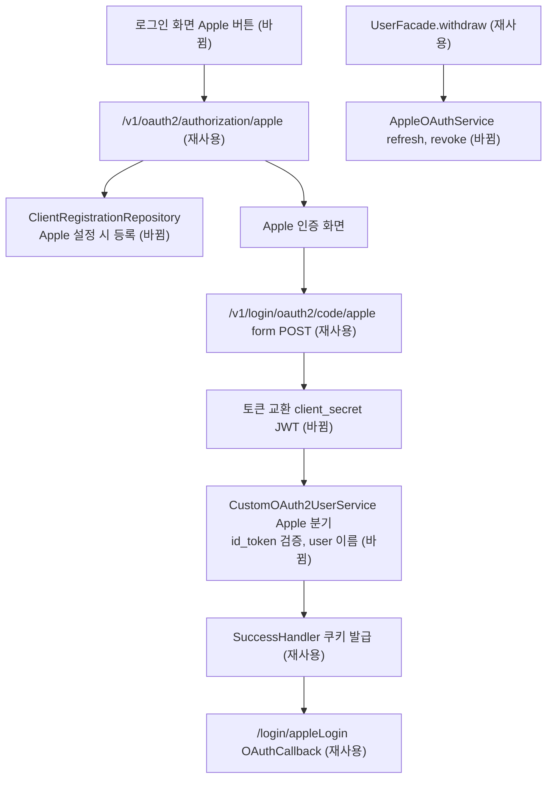

# Apple로 로그인 추가 — 명세

## 요구사항

- [ ] `app.auth.apple.{client-id,team-id,key-id,private-key,redirect-uri}`가 모두 있을 때만 `apple` ClientRegistration이 등록된다. 하나라도 비면 등록하지 않고 서버는 정상 기동한다.
- [ ] `/v1/oauth2/authorization/apple`이 `https://appleid.apple.com/auth/authorize`로 `response_type=code`, `scope=name email`, `response_mode=form_post`, `state`를 붙여 보낸다.
- [ ] Apple이 `/v1/login/oauth2/code/apple`로 보내는 form POST를 받아 토큰을 교환한다. 토큰 요청의 `client_secret`은 ES256 JWT이며 header `kid`, claims `iss`=Team ID, `sub`=Services ID, `aud`=`https://appleid.apple.com`, `iat`, `exp`를 가진다.
- [ ] 토큰 응답의 `id_token`을 Apple JWKS(`https://appleid.apple.com/auth/keys`)로 서명 검증하고 `iss`=`https://appleid.apple.com`, `aud`=Services ID, 만료를 확인한다. 검증 실패는 로그인 실패로 처리한다.
- [ ] 사용자 식별자는 `id_token.sub`, 이메일은 `id_token.email`이다. 이름은 첫 POST의 `user` JSON(`name.firstName`, `name.lastName`)에서 읽고, 없으면 이메일의 @ 앞부분을 쓴다.
- [ ] 탈퇴 시 저장된 Apple refresh token으로 access token을 받고 `https://appleid.apple.com/auth/revoke`에 `token_type_hint=access_token`으로 폐기한다.
- [ ] 웹 로그인 화면은 `NEXT_PUBLIC_APPLE_LOGIN_ENABLED=true`일 때만 "Apple로 계속하기" 버튼을 보이고, 콜백 `/login/appleLogin`은 기존 `OAuthCallback`을 쓴다.

## 설계

재사용: `oauth2Login` 설정, 쿠키 기반 인가 요청 저장소(쿠키가 `SameSite=None; Secure`라 Apple의 cross-site POST에도 실린다), `OAuth2AuthenticationSuccessHandler`, `CustomOAuth2AuthorizedClientService`(Apple 응답에 `refresh_token`, `expires_in`이 있어 `SocialToken.from`이 그대로 동작), `UserFacade.withdraw`와 `OAuthServiceFactory`, 웹 `OAuthCallback`과 `oauthLoginHref`.

새로 만드는 것:

- `AppleProperties`(`app.auth.apple.*`, `isConfigured()`), `AppleClientSecretGenerator`(jjwt 0.11.2로 ES256 서명, 요청마다 5분짜리 JWT 생성).
- `OAuthClientRegistrationConfig`: Boot의 `OAuth2ClientPropertiesMapper`로 기존 세 등록을 만들고, Apple이 설정됐으면 `apple` 등록을 더해 `InMemoryClientRegistrationRepository` 빈을 직접 만든다. 이 빈이 있으면 Boot 자동 구성은 물러난다.
- `AppleAwareTokenRequestConverter`: `OAuth2AuthorizationCodeGrantRequestEntityConverter.createParameters`를 오버라이드해 `apple`일 때만 `client_secret`을 생성값으로 바꾼다. `SecurityConfig`의 `tokenEndpoint().accessTokenResponseClient(...)`에 연결한다.
- `AppleIdTokenVerifier`: `NimbusJwtDecoder.withJwkSetUri(...)`(JWKS는 첫 검증 때 가져온다) + issuer·audience validator.
- `CustomOAuth2UserService`: `apple`이면 `super.loadUser`(userinfo 호출)를 건너뛰고 `id_token` 검증 결과와 `RequestContextHolder`의 `user` 파라미터로 속성 Map을 만든다. `AppleOAuth2UserInfo`가 이름 규칙(한글 성·이름은 붙여 쓰기, 그 밖에는 `firstName lastName`)과 이메일 앞부분 대체를 맡는다.
- `AppleClientProperties`, `AppleOAuthService`: 기존 `GoogleOAuthService` 형태로 refresh 요청과 revoke 요청.
- `Provider.APPLE`, `OAuth2UserInfoFactory` 분기.

## 버린 대안

- `openid` scope로 Spring OIDC 경로 사용: Apple이 `openid` scope를 받는지 공식 문서로 확인하지 못했고, `PrincipalDetails`를 `OidcUser`로 바꿔야 한다.
- `client-id`에 placeholder 기본값을 넣어 항상 등록: 설정 전에도 `/v1/oauth2/authorization/apple`이 Apple 오류 화면으로 보낸다.
- `client_secret`을 6개월짜리로 만들어 `.env`에 넣기: 6개월마다 손으로 갱신해야 한다.

## 함정

- Apple은 `name`/`email` scope를 요청하면 `response_mode=form_post`를 요구한다. 콜백이 POST로 온다.
- `user` 파라미터는 첫 인가 때만 온다. 연결을 해제한 뒤 다시 가입하면 다시 온다.
- Apple 반환 주소는 HTTPS 도메인만 허용한다. 로컬 프로필에서는 끝까지 확인할 수 없다.
- `.env` 한 줄에 PEM 줄바꿈을 넣기 어렵다. private key는 BEGIN/END 줄 유무, `\n` 문자열, 공백을 모두 허용해 본문만 추출한다.
- 운영 `auth_info.provider`가 MySQL ENUM이면 `APPLE` 저장이 실패한다(`ddl-auto=update`는 컬럼 타입을 바꾸지 않는다).

## 완료 기준

- `cd services/backend && ./gradlew test` 통과(Apple 단위 테스트 포함).
- `cd services/web && npm run lint && npm test` 통과.
- Apple 값이 없는 테스트 컨텍스트에서 `apple` 등록이 없고 나머지 세 등록이 있다.
