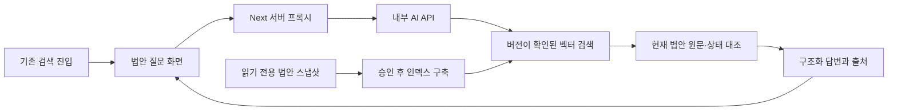

# 법안 질의응답 출시 — 명세

## 요구사항

- 공개 Next 서버 경로가 내부 Python API를 호출한다. 모델·Qdrant 인증은 서버에만 둔다. 내부 API는 인증 토큰·동시 요청·요청 길이·호출 빈도·일일 한도를 검사한다. 질문과 답변 본문을 앱 로그·DB에 저장하지 않는다.
- 입력은 질문 2~1000자, 22대/21대/전체 선택, 제한된 이전 질문·출처 문맥이다. 기본은 22대다. 질문을 URL에 넣지 않는다. IME 조합 Enter는 전송하지 않는다.
- 벡터 검색 결과의 스키마·임베딩 모델을 확인하고, 현재 DB의 READY 법안 원문·대수·처리 결과와 다시 대조한다. 오래되거나 누락된 자료를 검증된 근거로 사용하지 않는다.
- E5 기본 검색 임계값은 0.84다. 전체 색인에서 대상 법안 순위와 무관 질문의 근거 반환 여부를 함께 검증한다.
- 질문이 발의·제출 날짜 하나를 명시하면 검색 후보에서 현재 DB 발의일이 맞는 법안을 먼저 제공한다. 의결일·날짜 범위·여러 날짜는 기존 관련도 순서를 유지한다.
- 위원회별 가결 결과가 합쳐진 값은 근거의 처리 결과에서 생략하고 현재 처리 단계는 유지한다. 후속 질문은 대수 범위가 같거나 전체 대수로 넓어질 때 이전 출처를 이어서 사용한다.
- 생성 결과는 구조화된 문단·근거 ID로 받는다. 실제 제공한 근거만 연결하고 출처 없는 사실 문단·잘못된 ID·불완전한 생성 결과는 거절한다. 근거가 없으면 생성 호출 없이 근거 부족 상태를 반환한다. 법안의 처리 결과와 현행 법률 여부를 구분한다.
- 답변·근거 부족·400·429·503·시간 초과·중지를 구분한다. 재시도·새 질문·대화 초기화, 상세 왕복 후 대화 보존을 제공한다. 답변 갱신을 스크린리더에 알리고 기존 shadcn 컴포넌트·라이트/다크 토큰을 사용한다.
- 인덱스는 원문을 우선하고 법안 ID·내용 해시·대수·날짜·모델·스키마 버전을 보존한다. 생성·갱신은 명시적 실행 옵션 뒤에만 수행한다. 최초 전체 적재의 성공 건수와 원본 범위를 검증하고 새 버전으로 전환한다. 기존 실험 인덱스를 삭제·재생성하지 않는다.
- 데이터 기준일·인덱스 범위를 실제 메타데이터로 표시한다. 새 자료가 아직 반영되지 않은 상태를 숨기지 않는다. 운영 연결 전에는 출시 완료로 판정하지 않는다.

## 설계

기존 Python rag 모듈을 검색·근거 대조·구조화 생성으로 정리하고 FastAPI로 제공한다. Next /api/qa 프록시와 /ask 화면을 기존 검색 Dialog에 연결한다. 서버는 루프백에서만 수신하며 전용 환경과 배포 스크립트로 운영한다. 대화는 현재 Jotai Provider 안에서 보존한다.

## 근거·함정·완료 기준

운영 Qdrant 서버 1.15.3, 설치된 클라이언트 1.17.0에는 기존 search 메서드가 없다. 기본 bills 컬렉션은 없고 lawdigest_bills는 112건·2025-09-17~19다. 전용 서비스는 서버와 호환되는 SDK와 query_points 계약을 사용한다.

기본 임베딩은 384차원 multilingual-E5-small의 고정 revision·int8 ONNX 파일이다. 해시·토큰 길이·모델 ID를 확인한다. 질문에는 `query:`, 원문에는 `passage:`를 사용하고, 같은 임베딩 모델의 벡터만 검색한다. `text-embedding-3-small`은 명시적인 호환 설정에 남긴다. 답변 생성은 기존 gpt-5.4-mini의 별도 연결이다.

Python 회귀·실제 Qdrant 검색·구조화 출력 검증, 웹 lint/test/type/build, 데스크톱·375px·다크 화면에서 질문→답변→출처→뒤로 가기·취소·재시도를 확인한다. 공개 법안으로 실제 모델 응답도 검증한다. 임시 로컬 인덱스 검증과 운영 출시 검증을 구분한다. 운영 인덱스·배포·같은 조작까지 확인한 뒤 관련 결함을 닫는다.

공식 근거: [OpenAI 구조화 출력](https://developers.openai.com/api/docs/guides/structured-outputs), [Qdrant 1.15 Query API](https://api.qdrant.tech/v-1-15-x/api-reference/search/query-points), [FastAPI lifespan](https://fastapi.tiangolo.com/advanced/events/).
