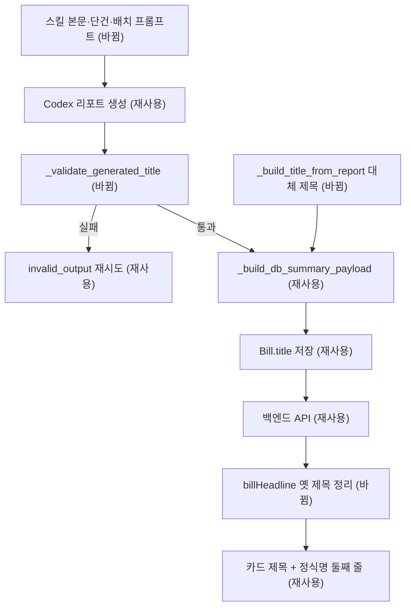

# 법안 제목을 "~하기 위한 법안" 설명형으로 바꾸기 — 명세

## 요구사항

- [ ] `_validate_generated_title`은 `^(?P<clause>.+?(?:기|을|를))\s+위한\s+법안$`에 맞고 clause가 25~80자인 제목만 통과시킨다. 정식 법안명으로 끝나는 옛 형식은 "제목형 계약" 오류로 실패한다.
- [ ] clause가 `.!?。` 또는 `입니다|합니다|것입니다|하였음|하고 있음|기관임`으로 끝나면 계속 실패한다.
- [ ] `REPORT_SKILL_BODY`, `build_bill_report_prompt`, `build_bill_report_batch_prompt`의 제목 규칙과 출력 스키마 예시가 새 형식을 요구한다. "짧은 명사형" 문구는 없다.
- [ ] `providers/openai_batch.py`의 `title` 필드 설명과 프롬프트도 같은 형식을 요구한다(대체 provider가 옛 형식을 내지 않게).
- [ ] `_build_db_summary_payload`는 `generated_title`이 없으면 `## 쉬운 요약` 첫 불릿의 "…위한" 부분에 " 법안"을 붙인 제목을 쓰고, 만들 수 없으면 기존 `bill.title`을 쓴다.
- [ ] `_title_topic_from_bill_name`(법안별 하드코딩)과 `_has_overlong_title_prefix`를 지운다.
- [ ] 웹 `billHeadline`은 "X(을|를|기) 위한 [정식명]"을 "X… 위한 법안"으로 바꾸고, 새 형식 제목은 그대로 둔다. 제목이 없거나 정식명과 같으면 정식명을 돌려준다.

## 설계

운영 `ai-summary` 작업은 Codex CLI로 `agentic_bill_report`를 돈다(`deploy/pipeline/lawdigest-pipeline-wrapper.sh`가 Codex를 필수로 확인). 스킬 본문은 `_write_report_codex_skill`이 실행마다 내용을 비교해 다시 쓰므로 프롬프트 수정은 배포 후 다음 실행부터 반영된다.

- 검증: `_validate_generated_title`의 정규식과 길이 기준만 바꾼다. 실패하면 기존 재시도 경로(`invalid_output`)를 그대로 탄다.
- 대체 제목: `_build_title_from_report(report_body)`를 다시 쓴다. 기존 `_markdown_section_body`, `_strip_markdown_for_summary`를 재사용한다.
- 웹: `services/web/lib/billHeadline.ts` 하나만 고친다. 카드·리포트·리포트 피드는 이미 `headline.endsWith(officialName)`이 거짓이면 정식명을 둘째 줄에 보인다. 타임라인과 다른 개정안 목록은 제목 글자만 바뀐다.

## 버린 대안

- 저장 형식을 "X을 위한 [정식명]"으로 두고 앞부분만 길게: 사용자가 "~하기 위한 법안" 형태를 골랐다.
- 기존 제목 일괄 재생성: 사용자가 신규 법안만 적용하기로 했다.
- 타임라인에 정식명 줄 추가: 타임라인 구성 변경은 먼저 물어야 하는 기준(48c52a4)이 있고 이번 요청 범위가 아니다.

## 함정

- clause 하한 25자는 최근 데이터(앞부분 중앙값 22자, 최대 32자)보다 높게 잡은 값이다. 너무 높으면 재시도가 늘어난다. 운영 첫 실행의 `invalid_output` 비율을 본다.
- `bill_name` 안에 "위한"이 들어간 법안(예: "…조성을 위한 특별법")의 옛 제목은 웹에서 끝의 정식명만 정확히 잘라야 한다. `endsWith(" " + official)`로 판단하므로 안전하다.
- 테스트 픽스처 다수가 `f"지원 근거 신설을 위한 {bill_name}"`을 쓴다. 새 검증에 맞게 바꿔야 한다.

## 완료 기준

- `cd services/ai && .venv/bin/python -m pytest tests -q` 통과
- `cd services/web && npx vitest run lib/billHeadline.test.ts`, `npm run lint` 통과
- 로컬 웹을 `https://api.lawdigest.kr`에 붙여 피드 카드 제목이 "~위한 법안"으로 끝나는지 화면으로 확인
