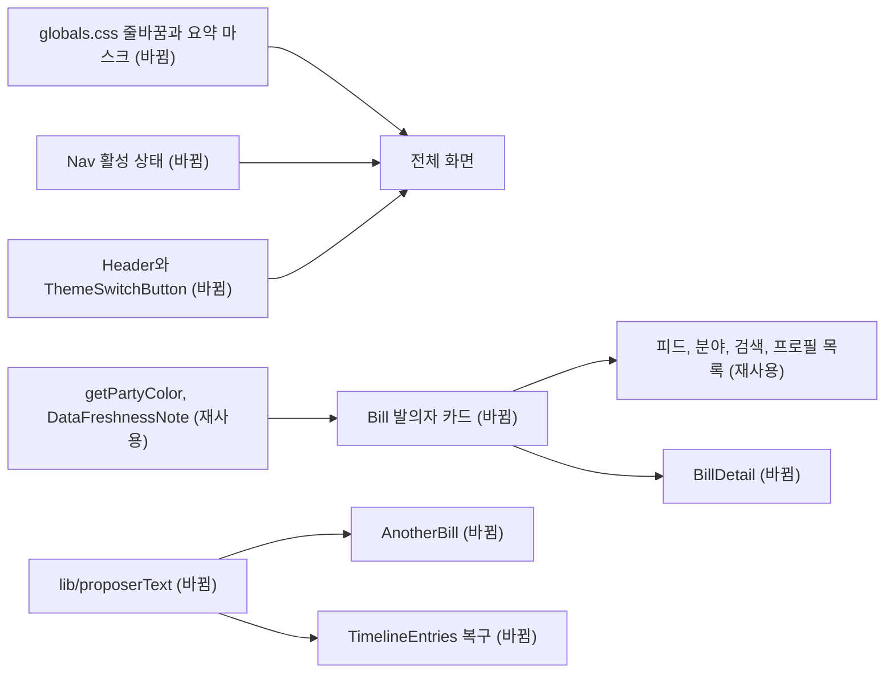

# 요구사항

- `styles/globals.css`: 문서 전체에 `word-break: keep-all`, `overflow-wrap: anywhere`를 적용한다. `h1`~`h3`에 `text-wrap: balance`, `p`, `li`에 `text-wrap: pretty`를 적용한다.
- `.lawdigest-summary-collapsed`: 높이 18rem인 `mask-image`를 위쪽에 고정한다. 18rem보다 짧은 요약은 흐려지지 않는다.
- `Nav`: `activeIndex < 0`이면 `has-no-active` 클래스로 indicator와 overlay를 숨긴다. 탭 이동과 드래그 동작은 유지한다.
- `--mobile-nav-shell`: 라이트 0.92, 다크 0.94. blur는 유지한다.
- `ThemeSwitchButton`, 아이콘: `currentColor`와 `text-foreground`를 쓴다.
- `Header`: `notification` 또는 `search` 화면의 md 이상에서 알림을 표시한다. 모바일의 `search` 화면에는 표시하지 않는다.
- `CongressmanDetail`: `commits`를 `, ` 기준으로 나눠 목록으로 표시한다. `shadow="none"`, 왼쪽 정렬, `기본정보` 제목, `약력` 토글 이름, `48세` 표기.
- `Bill` 발의자 카드: 부제 `발의자 N인`, 사진 경로가 없으면 `src`를 넘기지 않고 `showFallback`, `shadow="none"`, 로고 `h-8`, 카드 폭을 요약 열에 맞춘다.
- `ProposerList`: 빨간 `Badge`를 무채색으로, 두 글자 이름 분리 제거, `shadow-lg` 제거.
- `ProgressStage`: `items-start`, STEP 문구 제거, 라벨 왼쪽 선 통일.
- `Bill`/`BillDetail`: 세로 구분선을 잇고 관련 법안 영역의 좌우 여백을 `px-5`로 맞춘다.
- `AnotherBill`: `koreanDateLabel`로 날짜를 표시한다.
- `lib/proposerText.ts`(신규): `AnotherBill`의 표기 정규화를 옮겨 타임라인과 공유한다.
- 타임라인: `48c52a4`의 `TimelineBoard`, `ListContainer`, 네 목록의 화면을 복구한다. 네 파일의 중복은 `TimelineEntries.tsx`의 `BillSection`, `CommitteeSection`, `PlenarySection`으로 합친다. API 계약은 그대로이고 `party_info`, `party_vote_list` 타입만 되살린다. #242의 타임라인 기준을 대체한다.
- `TrendingKeywords`: 빈 목록이면 `null`. 코드 주석의 의도와 일치시킨다.
- 분야 화면: `CategoryBills` 목록에 `-mx-5`, `md:mx-0`을 적용해 `Bill`의 여백과 겹치지 않게 한다.
- `SiteFooter`, `about`, `login`: 왼쪽 선, `self-start`, 로고 간격을 맞춘다.
- `PartyLogo`, `PartyCongressmanItem`: 그림자와 중복 `의원` 라벨 제거, 사진 없는 경우 `showFallback`.

- `DataFreshnessNote`: `app/about`에서만 쓴다. `useDataFreshness`는 `StatsTrendArea`에서 계속 쓴다.
- `FeedFilterDropdown`(신규): `StageDropdown`과 대수 선택이 공유하는 pill 드롭다운. URL의 `assembly`, `stage` 계약은 유지한다.

- `ThemedPartyLogo`(신규): 라이트·다크 로고를 함께 렌더링하고 CSS로 전환한다. 수화 때 `src`가 갱신되지 않아 서버 렌더링 화면의 다크 로고가 어둡게 남는 문제를 고친다. `PartyProfileLogo`, `ProposerList`, `Bill`, `AnotherBill`이 공유한다.
- `Header`: md 구간 메뉴 좌우 여백을 줄여 820px의 가로 넘침을 없앤다.

# 설계

# 제약

- 데이터 계약과 API는 바꾸지 않는다. 색상 토큰은 `DESIGN.md`를 따른다.
- 기존 접근성 계약(키보드 초점, `aria-current`, `aria-controls`)을 유지한다.
- 로컬 확인은 프로덕션 빌드에서 하고, 운영 API의 쓰기 요청(`view_count` PATCH)은 차단한다.

# Open questions

- 로고 무지개 선 위치: 코드 변경 없이 사용자에게 묻는다.
