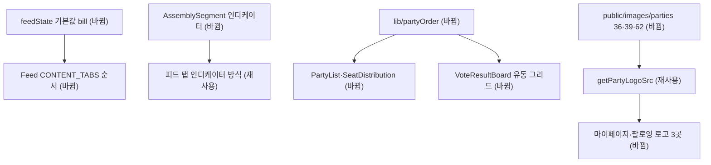

# 피드 기본 탭·표결 범례·국회 토글·정당 로고 정리 — 명세

## 요구사항

- [ ] `feedContent(null)`이 `'bill'`을 돌려주고, `CONTENT_TABS` 순서가 bill → report → following이다
- [ ] 법안 탭 클릭 시 `tab` 쿼리를 지워 기본 주소 `/`를 유지한다
- [ ] `VoteResultBoard` 항목에 고정 폭이 없고, 가장 긴 항목(136px)이 들어가면 2열이다
- [ ] 로고 원은 이미지 로드 실패 시에도 대체 텍스트를 원 밖으로 내보내지 않는다
- [ ] `AssemblySegment` 선택 표시가 `transform` 전환으로 이동하고 `prefers-reduced-motion`에서는 전환이 없다
- [ ] 정당 36·39·62 로고(일반), 36·62(다크)가 `public/images/parties`에 있고 `getPartyLogoSrc`가 이를 쓴다
- [ ] 정당 로고를 직접 조립하던 3개 파일이 `getPartyLogoSrc`를 쓴다
- [ ] 무소속을 맨 뒤로 보내는 정렬을 정당 목록·의석 범례·표결 범례가 공유한다

## 설계

- 피드: `lib/feedState.ts`의 기본값과 `Feed.tsx`의 `CONTENT_TABS` 순서만 바꾼다. 인디케이터 위치는 기존대로 인덱스로 계산한다(재사용).
- 범례: `grid-cols-[repeat(auto-fill,minmax(max(8.5rem,calc(50%-0.375rem)),1fr))]`로 최대 2열, 칸 폭 136px 미만이면 1열. 정당명은 `min-w-0 flex-1 truncate`, 표 수는 `shrink-0`.
- 토글: HeroUI 2.2.8 `Tabs` 커서는 framer-motion `layoutId`에 의존하고 이 환경에서 이동하지 않는다(피드 정렬 탭도 동일, HeroUI 2.2.29는 CSS 커서로 교체). 피드 콘텐츠 탭의 방식(절대 위치 인디케이터 + `translateX` + CSS transition)을 재사용해 `AssemblySegment`에 인디케이터를 둔다.
- 로고: 기존 1~10번 로컬 로고는 Object Storage 원본과 바이트 단위로 같다. 같은 원본에서 36·39·62를 받아 `LOCAL_PARTY_LOGO_IDS`, `LOCAL_DARK_PARTY_LOGO_IDS`에 추가한다(재사용).
- 무소속: `lib/partyOrder.ts`에 `sortPartiesIndependentLast(parties, name, count)`를 새로 두고 `PartyList`, `SeatDistribution`, `VoteResultBoard`가 쓴다. 판별은 정당 이름 `무소속`.

## 버린 대안

- HeroUI `Tabs`로 토글 교체: 커서 애니메이션이 동작하지 않아 버렸다.
- HeroUI 전체 업그레이드: theme·system 동반 업그레이드로 영향이 앱 전체라 별도 작업으로 뺐다.
- 범례 정당명 말줄임으로 2열 강제: '더불어민주…'처럼 정당명이 잘려 버렸다.

## 함정

- 운영 웹은 `NEXT_PUBLIC_IMAGE_URL`이 Object Storage지만 `deploy-web-release.sh` 기본값 `https://api.lawdigest.kr`은 로고 경로에 401을 낸다.
- `orderPartiesByBloc`는 내부에서 다시 정렬하므로 좌석 배치는 무소속 정렬의 영향을 받지 않는다.

## 완료 기준

`npm run lint`, `npx tsc --noEmit`, `npx vitest run`이 통과하고, 개발 서버에서 개발 목표 다섯 항목을 확인한다.
