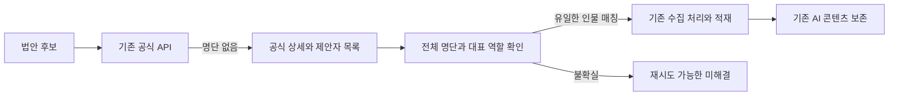

# 법안 재수집과 최신 발의자 정보 복구 — 명세

- API 발의자 조회 결과가 비었을 때만 공식 의안정보시스템을 보완 출처로 사용한다. 기존 Session과 timeout을 사용하고 주소·법안 ID를 검증한다.
- 상세 화면의 billId·billNo와 대표발의자, 제안자 목록의 전체 수·페이지를 확인한다. 수집된 명단이 전체와 일치해야 한다. 네트워크 오류와 구조 변경은 해당 법안의 재시도 가능한 실패로 남긴다.
- 공식 명단의 이름·한자명과 의원 명부를 대조하고 유일한 MONA_CD만 사용한다. 한 명이라도 해결되지 않거나 대표발의자를 확인하지 못하면 부분 명단을 적재하지 않는다. 첫 행을 대표로 간주하지 않는다.
- DataProcessor는 대표발의자 ID 필드를 보존한다. 법안명 괄호의 일반 부가 설명을 발의자 이름으로 해석하지 않는다.
- 원문 재수집의 gpt_summary가 null·빈 문자열·공백이면 기존 AI 요약을 보존한다. 원문에서 만든 제목으로 기존 표시 제목을 덮어쓰지 않는다. 제목만 생성된 결과도 보존한다. 태그 null·빈 문자열도 기존 값을 보존한다. 명시된 새 AI 결과의 갱신과 최초 적재는 유지한다.
- 조회수·기존 생성일을 보존하고 운영 스키마 변경을 추가하지 않는다.
- 의원 단건/부분 upsert는 다른 의원의 현직 상태를 바꾸지 않는다. 전체 동기화는 API의 선언된 전체 건수와 실제 수집 건수·코드 유일성을 확인한 뒤 명시적으로 실행한다. 누락·중복·빈 명부는 비활성화 전에 거절한다. 신규 의원의 대수와 기본 프로필 필드를 함께 저장한다. 공식 선출 구분을 함께 저장하고, 입력에서 이 값이 빠지면 저장된 값을 보존한다.

검증은 fixture 기반 발의자 역할·페이지/누락/중복 이름, MySQL 실제 upsert 반복 적재, 기존 data 회귀 검사, 운영 API를 읽는 dry_run이다. 운영 쓰기는 포함하지 않는다. 코드 검증 뒤 공식 표본의 실제 10명과 대표발의자 일치를 확인한다.

근거: 2026-11-03 운영 dry_run 29건 거절, 기존 7월 표본의 API 명단 14명과 최신 표본 INFO-200, 같은 최신 표본의 공식 상세와 제안자 팝업 10명. [국회사무처 제안자정보 API](https://www.data.go.kr/data/15126095/openapi.do), [공식 상세 표본](https://likms.assembly.go.kr/bill/billDetail.do?billId=PRC_T2U6T0O9P0N8N1M4N4L5L0U0S4S6Q8).
