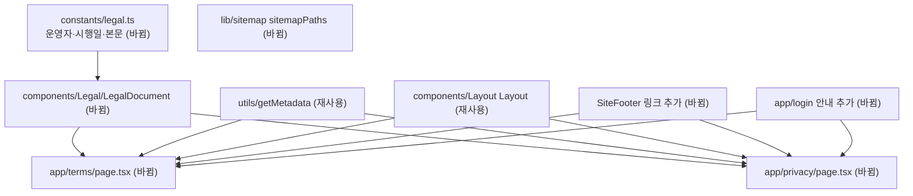

# 이용약관과 개인정보 처리방침 공개 — 명세

## 요구사항

- [ ] `/privacy`에 개인정보 보호법 제30조 제1항 중 해당 항목(목적, 처리·보유 기간, 제3자 제공, 파기, 위탁, 정보주체 권리, 보호책임자, 자동 수집 장치)과 시행령 제31조 제1항 중 해당 항목(처리 항목, 국외 이전, 안전성 확보 조치)이 모두 있다.
- [ ] 국외 이전 항목에 제28조의8 제2항 사항(항목, 국가, 시기·방법, 이전받는 자와 연락 경로, 목적·보유 기간, 거부 방법과 효과)이 있다.
- [ ] `/terms`에 가입 조건(만 14세 이상), 탈퇴, AI 요약·질의응답 한계, 공개 자료 출처, 금지 행위, 책임 제한, 약관 변경 절차, 준거법이 있다.
- [ ] 두 페이지 모두 시행일, 운영자, 연락처를 상수 한 곳에서 읽는다.
- [ ] 두 페이지는 로그인 없이 열리고 `getMetadata`로 제목·설명·canonical을 가진다.
- [ ] `SiteFooter`에 `/terms`, `/privacy` 링크가 있고 처리방침 링크는 `font-semibold`와 본문색으로 다른 링크와 구분된다.
- [ ] `/login`의 버튼 아래에 동의 안내, 만 14세 안내, 두 문서 링크가 있다.
- [ ] `sitemapPaths`에 `/terms`, `/privacy`가 있다.

## 설계

- 재사용: 페이지 틀은 `app/about/page.tsx`의 `Layout` + `article` 구조와 `getMetadata`를 그대로 쓴다. 하단 링크는 `components/Layout/SiteFooter.tsx`의 `linkClass`를 쓴다. 로그인 안내는 `app/login/page.tsx`의 기존 섹션 안에 둔다.
- 새로 만듦: `constants/legal.ts`에 `LEGAL_OPERATOR`(운영자, 책임자, 이메일, 시행일)와 두 문서의 본문 데이터(`TERMS_DOCUMENT`, `PRIVACY_DOCUMENT`)를 둔다. 본문은 `{ id, title, blocks }` 배열이고, block은 문단(`p`), 목록(`ul`/`ol`), 표(`table`) 중 하나다.
- 새로 만듦: `components/Legal/LegalDocument.tsx` 서버 컴포넌트가 제목, 시행일, 목차(앵커 링크), 조항을 그린다. 조항 제목은 `h2`, 목차는 `nav aria-label="목차"`. 본문 폭은 `max-w-prose`, 표는 모바일에서 가로 스크롤 컨테이너에 넣는다.
- 문서 문구 근거: 법 제30조·시행령 제31조·제28조의8 조문 구성(itwiki 전사본, 국가법령정보센터 원문 대조 권장), OpenAI 데이터 통제(help.openai.com 7730893, ChatGPT 계정 로그인 Codex는 계정의 모델 학습 설정을 따름). 근거 URL은 `constants/legal.ts` 주석에 남긴다.
- 처리 사실 근거: OAuth scope(`application.properties`), 탈퇴 삭제 범위(`UserFacade.withdraw`), 질의응답 질문 미저장(`RagConversationState`, Codex `--ephemeral`), 요청 한도 식별값(일 단위 HMAC, 메모리 보관, `limits.py`), 쿠키(`CookieUtil` httpOnly, refresh 7일), 브라우저 저장소(`lib/search.ts` 최근 검색어, 테마).

## 버린 대안

- 마크다운 파일을 읽어 렌더링: 마크다운 렌더러 의존성이 없고, 표·목차 구조를 타입으로 검사할 수 없다.
- 하단 대신 설정 드롭다운에만 링크: 로그인하지 않은 이용자가 볼 수 없다.

## 함정

- 피드는 무한 스크롤이라 하단 링크에 닿기 어렵다. 마이페이지, 로그인, 소개 같은 일반 페이지 하단과 로그인 화면 안내로 접근 경로를 보완한다.
- 모바일 하단 내비게이션이 하단을 가리지 않도록 `SiteFooter`의 기존 하단 여백을 유지한다.
- 메모리 규칙: 콘텐츠 화면 위에 기준일·출처 문구를 두지 않는다. 시행일은 법적 문서 자체의 필수 정보이므로 문서 페이지에만 둔다.

## 완료 기준

- `npm run lint`, `npm run test`, `npx tsc --noEmit`이 통과한다.
- 개발 서버에서 `/privacy`, `/terms`, `/login`, `/mypage` 하단을 열어 링크·목차 앵커·표가 데스크톱과 375px 폭, 다크 모드에서 보인다.
