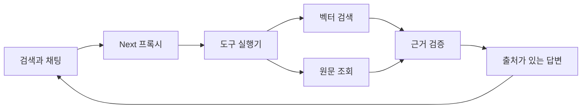

# RAG 검색과 에이전틱 채팅 명세

## 요구사항
- 기존 /v1/answers와 /api/qa를 보존한다. /v1/search, /v1/chat와 대응 Next 경로를 추가한다.
- 검색은 모델 생성 없이 검증된 원문을 반환한다. 채팅은 초기 검색 후 모델이 search/read/answer 중 다음 행동을 선택한다. 추가 도구 실행은 최대 3회, 근거는 최대 8건이다.
- 대수·원문 해시 검증, 현재 DB 상태, 근거 부족, 문단별 출처 검증을 공통 사용한다. 원문 조회는 현재 요청에서 확보한 법안 ID에 한정한다.
- Expresso의 런타임/도구 경계, 동일 ID 상태 갱신, 중지 전파 패턴을 Python/Next 구조로 이식한다. 현재 Codex 구조화 생성 연결을 사용하며 실행기에는 허용된 읽기 전용 도구만 둔다.
- 채팅은 SSE로 실제 도구 상태와 검증 완료 답변을 전달한다. 중지·연결 종료 시 실행 취소 신호를 보내고 모델 프로세스를 종료한다. 모델 호출별 25초, 전체 110초 제한을 둔다.
- 조회 판단 모델의 실행이 실패하면 이미 검증한 근거가 있을 때만 그 범위에서 답변을 시도하고 조회 제한을 알린다. 최종 출처 검증과 근거 부족 계약은 그대로 적용하며 서버 오류와 연결 오류를 구분한다.
- 기존 프록시 인증·동일 출처 검사·요청 크기·호출 한도를 모든 신규 경로에 적용한다. 대화는 현재 브라우저 메모리에서만 보존한다.
- 새 검색바에서 키워드 검색·의미 검색·AI 채팅을 선택한다. 데스크톱 상단과 모바일 하단이 입력·전송·중지를 함께 제공하며 /ask는 결과·대화를 표시한다. shadcn ToggleGroup, Message, Bubble, Badge를 재사용한다. 질문은 URL·최근 검색 기록에 넣지 않는다.
- 실제 운영 DB·Qdrant에는 SSH 루프백 터널로 읽기 전용 연결한다. 검증된 E5 파일과 실제 생성 모델을 사용한다. 비밀 설정은 .runtime/에만 저장하고 Git에 포함하지 않는다. 운영 API·인덱스를 수정하지 않는다.

## 범위
운영 배포·색인 갱신은 별도다. Expresso 소스는 참조하며 변경하지 않는다.
