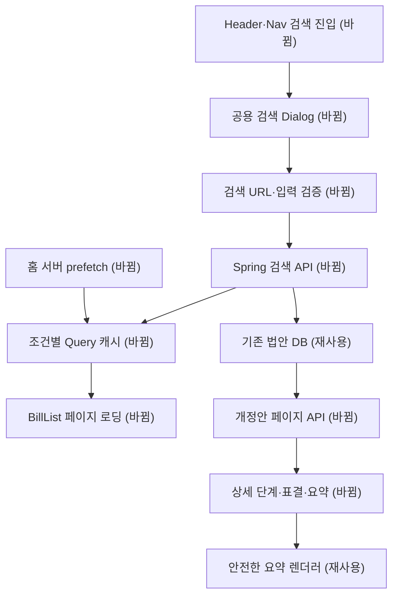

# 모두의입법 1차 핵심 화면 복구 — 명세

## 요구사항

- [ ] W5: 목록의 다음 페이지는 hasNextPage와 isFetchingNextPage로 제어한다. 마지막 페이지·빈 첫 페이지는 추가 요청을 만들지 않는다. 검색어·의원/정당 ID·발의 유형·단계를 캐시 키에 포함한다. 복제 상태와 수동 refetch 효과를 제거한다.
- [ ] 홈의 서버 prefetch와 클라이언트가 같은 query options를 쓰고 HydrationBoundary로 첫 페이지를 전달한다. 공개 목록 페이지 크기는 10건으로 맞춘다. 피드 탭·정렬·필터는 URL로 보존하며 뒤로 가기 시 목록과 스크롤을 확인한다.
- [ ] W6: 공백·법안 검색 2자 미만·음수 페이지 등 유효하지 않은 요청은 400이다. 의원 검색의 유효한 한 글자 입력은 유지하며 법안 섹션에 최소 길이를 안내한다. 한 영역의 실패로 다른 결과를 지우지 않는다.
- [ ] FULLTEXT 연산자를 사용자 입력과 분리하고 토큰에서 안전한 검색식을 구성한다. 법안명 일치·검색 점수·발의일·ID 순으로 안정 정렬하며 BillService의 재조회가 검색 순서를 덮어쓰지 않는다. 괄호 포함 법안명, 소방+, @@, 5·18, R&D, /, #, %를 회귀 검증한다.
- [ ] URL 생성·입력 정규화·최근 검색어 저장을 공용화한다. 잘못된 퍼센트 인코딩에도 결과 화면이 실패하지 않는다. 검색 결과 로딩·빈 상태·실패·재시도를 구분한다. 의원 결과는 일치도·현직·이름으로 정렬하고 초기 노출을 제한하며 전체 결과를 펼친다. 전직 표시에 필요한 상태·대수 계약을 보완한다.
- [ ] Header와 Nav가 공용 검색 Dialog를 연다. 입력의 지우기는 경로를 바꾸지 않는다. 접근 가능한 이름, 입력 오류 연결, Esc 닫기, 포커스 가두기·복귀, 배경 스크롤 잠금과 경로 변경 시 닫기를 제공한다. 기존 검색 중간 입력 단계를 제거한다.
- [ ] W3 웹: API 단계 값과 표시 라벨을 분리한다. 체계자구 심사·정부이송·철회·알 수 없는 값이 위원회 심사로 대체되지 않는다. 알려진 종료 결과를 표시하고 마지막 도달 단계가 없으면 임의로 만들어 내지 않는다.
- [ ] 가결·부결 결과와 표결 기록 유무를 구분한다. null·0·비정상 값으로 차트를 만들지 않는다. 유효한 기록은 실제 찬성·재석 수와 단위를 표시한다. 고정 분모 300을 제거하며 정당별 기록이 없다는 사실도 구분한다.
- [ ] DETAIL-07: 상세에 포함되는 다른 개정안과 새 페이지 API를 연결해 첫 전송·렌더링을 제한한다. 최신순과 ID로 안정 정렬하고 다음 페이지·마지막 페이지·이전 대수/처리 결과를 표시한다. 기존 응답 필드는 호환한다.
- [ ] W11 일부: 요약 래퍼에서 button 역할·aria-label·클릭 토글을 제거한다. 펼치기 버튼에 aria-expanded와 aria-controls를 연결하고 상세에서는 불필요한 토글을 없앤다. 피드 탭 선택 의미와 라이트·다크 텍스트 대비 4.5:1 이상을 확보한다. 정당 강조색은 유지한다.

## 설계

기존 Next App Router, Spring API, TanStack Query, BillList, 안전한 마크다운 렌더러를 재사용한다. query options와 페이지 끝 판정을 공용화한다. 새 shadcn/ui Dialog·InputGroup·Button·Skeleton을 기존 Header·Nav에 연결하고 기존 토큰과 Tailwind 3 환경을 보존한다. 컴포넌트 추가는 CLI의 변경 미리보기와 생성 파일 검토를 거친다.

검색 서버는 입력 검증과 검색식 생성 책임을 나누고, 검색 ID 순서를 DTO 재조회 후 복원한다. 다른 개정안은 전용 페이지 API와 작은 첫 응답으로 전송량을 제한한다. W3는 현재 API가 제공하는 단계·결과·표결 값을 해석하며 운영 데이터 갱신은 W1로 추적한다.

## 현재 재현 근거

기준은 최신 main f3bb744이며 아래는 2026-11-02에 다시 확인한 결과다. 세부 캐시 전환·뒤로 가기 등 아직 직접 조작하지 않은 항목은 해당 파일 수정 전에 재현한다. 재현되지 않는 항목은 수정 대상에서 제외하고 이유를 남긴다.

| 항목 | 다시 확인한 근거 |
| --- | --- |
| SEARCH-01 / PROFILE-01 | 의료법 API 200·5건·last_page=false, 실제 검색 끝 스크롤 후에도 카드 5개. 의원 API 3건·last_page=false. 의원 화면은 첫 진입 후 빈 목록이 지속됨. BillList.tsx:28,33은 피드 시간순에서만 관찰 요소를 렌더함. |
| SEARCH-02 / SEARCH-03 | 김, 괄호 포함 외국환거래법명, page=-1 요청 모두 500. SearchController.java의 길이 예외와 GlobalExceptionHandler 매핑 누락, BillRepository.java의 boolean mode 조립을 확인함. |
| SEARCH-05 / FEED-04~07 | 검색 쿼리 키에 검색어가 없고 피드 키에 단계가 없음. 프로필 키에 발의 유형이 없음. Home prefetch 결과를 dehydrate하지 않음. 실제 프로필 빈 목록과 React #418 로그 확인. |
| SEARCH-04 | SearchBar.tsx:58에 /search 이동 코드가 있고 해당 경로는 감사 시점 404. 이번 IAB의 지우기 클릭에서는 URL 이동을 확인하지 못했으므로 로컬에서 실제 클릭 경로를 추가 재현한 뒤 처리함. |
| TRUST-03 / DETAIL-01 | 체계자구 심사·정부이송·철회 API 표본과 웹의 체계지구/정부 이송 상수, indexOf 실패 시 1 대체를 확인함. |
| TRUST-02 / DETAIL-04 / DETAIL-07 | 원안가결 표본 PRC_Z2Y6K0Z4W2W7T1B7U5L9I4C7F6N8C3은 찬성·재석 null이고 다른 개정안 761개. HalfDonutChart.tsx:58은 MAX_COUNT=300. |
| A11Y-01 / A11Y-02 | 실제 DOM에 요약 전체 button 역할 존재. 피드 다크 모드 전환 후 탭 글자 소실을 화면으로 확인함. |

## 버린 대안과 함정

- 클라이언트에서 761건을 접기만 하면 첫 전송량과 서버 조회 비용이 남는다. 서버 페이지네이션을 포함한다.
- 전체 화면에서 한 글자 검색을 막으면 유효한 의원 검색도 막힌다. 유형별 조건을 안내한다.
- API 순위만 바꿔도 후속 법안 재조회가 발의일순으로 재정렬한다. 검색 ID 순서를 끝까지 유지해야 한다.
- 현재 BillInfoDto의 피드 필드에는 대수·처리 결과가 충분하지 않다. 21대 기본 필터 및 피드 상태 정합은 W3 후속 백엔드 작업으로 남기며 웹만 고쳐 완료 처리하지 않는다.
- RAG Python 모듈은 존재하나 공개 API·웹 연결·운영 인덱스 상태는 미확인이다. 출시를 별도 intent로 이어 진행하고 자연어 질문 결함은 계속 추적한다.

## 완료 기준과 공식 근거

변경 서비스의 린트·테스트·타입검사·빌드와 실제 UI 조작이 통과하고, PR 머지·운영 배포 후 같은 표본에서 수정 결과를 확인한다. 배포 전 이슈를 닫지 않는다. 운영 데이터 정지·RAG·전체 대수 필터 등 남은 작업의 해결 여부는 별도 추적한다.

- [TanStack Query 조건별 키](https://tanstack.com/query/latest/docs/framework/react/guides/query-keys), [서버 렌더링과 HydrationBoundary](https://tanstack.com/query/latest/docs/framework/react/guides/ssr)
- [MySQL boolean FULLTEXT 문법](https://dev.mysql.com/doc/refman/8.0/en/fulltext-boolean.html)
- [shadcn Dialog](https://ui.shadcn.com/docs/components/base/dialog), [InputGroup](https://ui.shadcn.com/docs/components/base/input-group)
