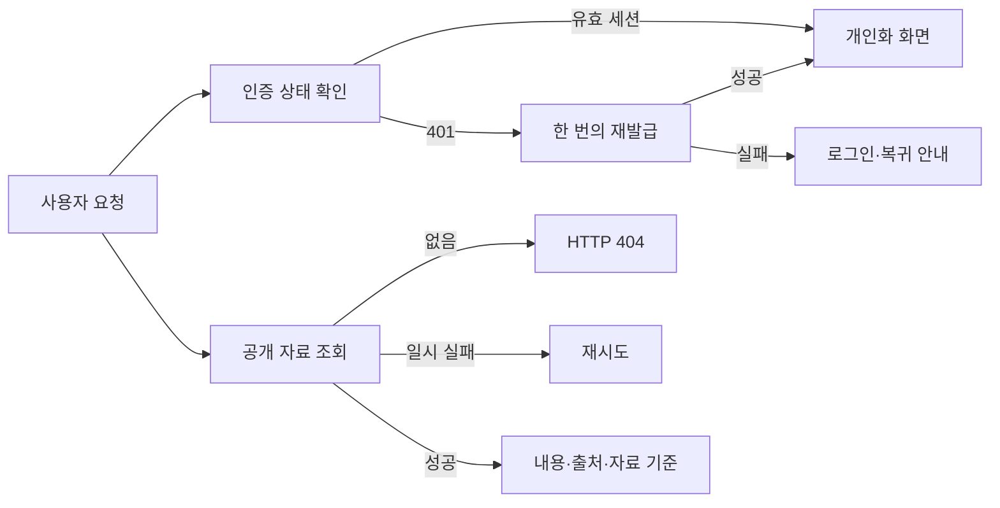

# 요구사항과 설계

2차 화면은 인증 상태·실패 종류·자료 기준을 실제 응답에 맞춰 표시한다.

- W7: 실제 계정으로 재현 후 인증 인터셉터의 훅 호출을 제거한다. 동시 401은 재발급 Promise 하나를 공유하고 재발급 요청의 재귀를 막는다. 성공 시 같은 axiosInstance로 원 응답을 반환하고, 실패 시 인증·개인화 캐시를 정리한다. 서버의 재발급 실패는 401이다.
- 인증 확인 전에는 SSR·클라이언트가 같은 로딩 상태를 렌더한다. 공개 화면의 서버 데이터와 사용자별 스크랩·팔로우 상태를 구분하며 사용자 전환 때 개인화 캐시를 비운다. OAuth 오류·취소와 허용한 내부 복귀 주소를 처리한다.
- W8: 마이페이지의 계정·로그아웃·탈퇴 진입점, 삭제 결과 확인, 알림의 로딩·오류·빈 상태·페이지 이동·처리 후 목록 갱신을 연결한다. 탈퇴 실제 실행에는 별도 승인이 필요하다.
- W9: 잘못되거나 없는 법안·의원·정당 URL은 HTTP 404와 해당 제목을 반환한다. 데이터 확인 뒤 notFound를 호출하며 스트리밍 때문에 200으로 바뀌는지 production build에서 검사한다. 일시적 장애에는 재시도와 이동 경로를 둔다. 서버 예외·스택·접속 정보는 공개 응답으로 전달하지 않는다.
- 없는 의원의 공개 API는 404를, 메인피드의 음수 페이지·0 이하 크기·잘못된 단계는 400을 반환한다. 없는 정당의 안내는 ‘정당’으로 표시한다.
- 전역 로고 스플래시를 화면에 맞는 loading 상태로 바꾼다. 헤더 중복과 교체를 줄이며 존재 확인이 필요한 상세 경로의 404를 보존한다. 목록의 빈 상태는 필터·검색 해제 등 실제 복구 동작과 연결한다.
- W2: 공개 자료 기준 계약에 READY 법안의 최신 발의일과 타임라인의 최신 기록 날짜를 각각 제공한다. AI 제목·요약이 없는 신규 수집 법안도 수집 기준에 포함한다. 기록된 수집·생성 시각이 있는 경우에만 그 의미로 표시한다.
- 목록·상세의 AI 표식·원문 링크를 공용 요소로 만들고 특정 모델의 하드코딩을 제거한다. 프로필·타임라인·탐색에 자료 기준과 출처를 연결한다. 월별 추이는 수집 범위를 넘는 기간과 집계값 0을 구분한다. 가결 정의의 통합은 W4에서 진행한다.
- 운영 주체·공개 연락처·보관 기준은 사용자 제공 정보와 실제 수집 항목으로 정책을 작성한다. 필수 정보가 비어 있는 정책은 완성된 운영 정책으로 공개하지 않는다.

완료 조건은 관련 결함의 직접 재현 후 실제 화면에서 해결 확인, 서비스별 lint/test/build, 375px·데스크톱·라이트/다크 확인이다. 실제 계정의 로그인·30분 뒤 요청·개인화·알림·승인된 탈퇴와 운영 정책 정보 확인은 별도 증거로 남긴다.

## 확인 대기

현재 브라우저는 비로그인 상태다. 실제 계정 로그인은 사용자에게 요청했다. 운영 주체·문의·보관 기준은 모두 미정이다. 이 정보가 필요한 흐름의 완료를 추정하지 않고 독립적으로 재현할 수 있는 부분부터 진행한다.
